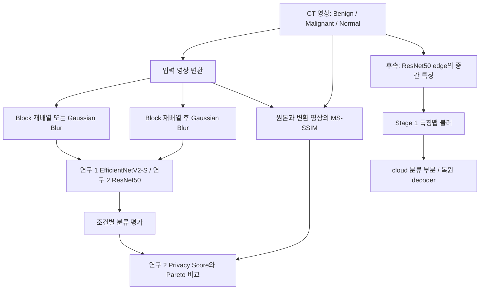

<div align="center">

<a name="폐암-영상-분류와-프라이버시-변환-실험"></a>
<a name="폐-ct-영상-변환과-분류-성능을-비교합니다"></a>

# 🫁 Lung CT Privacy Project

블러·블록 변환이 폐 CT 분류 성능과 프라이버시에 미치는 영향을 비교합니다.

**기술 분류:** 컴퓨터 비전 › 딥러닝 영상 분류 › 입력·특징 변환과 프라이버시 평가

`Python` `TensorFlow` `Jupyter` `논문·연구 자료`

[빠른 시작](#quick-start) · [저장소 구성](#repository-structure) · [데이터와 평가](#data-settings) · [연구 단계](docs/RESEARCH_STAGES.md) · [하계 논문](%EB%85%BC%EB%AC%B8/1%EC%B0%A8_EfficientNetV2-S_%ED%95%98%EA%B3%84_%EC%B5%9C%EC%A2%85.pdf) · [ResNet50 논문](%EB%85%BC%EB%AC%B8/2%EC%B0%A8_ResNet50_%EC%B5%9C%EC%A2%85.pdf) · [버전 기록](docs/VERSIONS.md)

[핵심 구성](#input-processing-output)

</div>

## 📄 내 논문 PDF

[현재 원문 PDF·공식 링크 교체 위치](docs/PAPERS.md) · [모든 실제 차수·최종본·전체 비교](docs/REVISION_INDEX.md)

- **연구1 · 하계 EfficientNetV2-S**: [PDF 원문](%EB%85%BC%EB%AC%B8/1%EC%B0%A8_EfficientNetV2-S_%ED%95%98%EA%B3%84_%EC%B5%9C%EC%A2%85.pdf) · [편집 원본](%EC%97%B0%EA%B5%AC1_%ED%95%98%EA%B3%84_EfficientNetV2-S/%EB%85%BC%EB%AC%B8/%EC%9B%90%EB%AC%B8_%EC%B5%9C%EC%A2%85.hwp.md)
- **연구2 · ResNet50 후속**: [PDF 원문](%EB%85%BC%EB%AC%B8/%EC%97%B0%EA%B5%AC2_%EC%9B%90%EB%AC%B8_%EC%B5%9C%EC%A2%85.pdf) · [편집 원본](%EB%85%BC%EB%AC%B8/%EC%97%B0%EA%B5%AC2_%EC%9B%90%EB%AC%B8_%EC%B5%9C%EC%A2%85.hwp.md)

공식 공개 URL은 아직 등록하지 않았습니다. 추후 [논문 전용 표](docs/PAPERS.md)의 교체 칸과 이 항목을 함께 갱신합니다.

## 🗂️ 모든 실제 차수와 최종본

**연구 1·2는 논문 단계, 폴더 1~4차는 자료 차수입니다.** 블러·블록의 1·2차 실험도 별도 구분입니다. 각 설명에서 실제 파일과 크기·해시를, 전체 차이에서 공백·주석을 포함한 텍스트 변경을 볼 수 있습니다.

| 단계 | 설명 | 파일 종류 | 전체 차이 |
|---|---|---|---|
| [연구1 · 하계 EfficientNetV2-S](docs/revisions/study-1.md) | 하계 3쪽 논문. EfficientNetV2-S로 입력 Blur·Block을 각각 비교합니다. 정확도·ROC-AUC·혼동행렬과 발표·그래프 자료를 연결합니다. | docx·hwp·ipynb·pdf·pptx | [직전 단계 비교](docs/revision-diffs/study-1.diff) |
| [연구2 · ResNet50 후속 원고](docs/revisions/study-2.md) | 후속 19쪽 원고. ResNet50의 단독 20조건·조합 100조건과 입력 영상 MS-SSIM 기반 Privacy Score를 비교합니다. | hwp·ipynb·pdf | [직전 단계 비교](docs/revision-diffs/study-2.diff) |
| [폴더 1차](docs/revisions/folder-1.md) | ResNet50 단독 실험의 rebuilt·same_settings·metric_matched 노트북과 수정 보조 스크립트입니다. | ipynb·js·py | [직전 단계 비교](docs/revision-diffs/folder-1.diff) |
| [폴더 2차](docs/revisions/folder-2.md) | Blur·Block 설정 정렬, 조합 노트북 생성, 원본 복원 스크립트입니다. 실행 경로를 별도로 맞춰야 합니다. | mjs | [직전 단계 비교](docs/revision-diffs/folder-2.diff) |
| [폴더 3차](docs/revisions/folder-3.md) | Privacy Score 계산의 소규모 검사 자료입니다. n_images=3, 블록 2·블러 2·조합 4조건의 표와 비의료 도표를 보존합니다. | csv·ipynb·png·py·xlsx | [직전 단계 비교](docs/revision-diffs/folder-3.diff) |
| [폴더 4차](docs/revisions/folder-4.md) | ResNet50 후속 원고 사본과 학습·지표·도표 코드를 모았습니다. 개인 검토 로그와 의료 원영상은 제외합니다. | hwp·ipynb·pdf | [직전 단계 비교](docs/revision-diffs/folder-4.diff) |
| [블러 · 2차 실험](docs/revisions/experiment-6.md) | 입력 영상에 σ0~256의 Gaussian Blur 10조건을 적용하고 ResNet50으로 분류합니다. 테스트를 먼저 분리한 뒤 학습 자료를 증강합니다. | ipynb·json | [직전 단계 비교](docs/revision-diffs/experiment-6.diff) |
| [블록 · 2차 실험](docs/revisions/experiment-7.md) | 입력 블록을 512~1 크기로 재배열하는 ResNet50 10조건 실험입니다. 이 사본은 증강 후 테스트를 나눕니다. | ipynb·json | [직전 단계 비교](docs/revision-diffs/experiment-7.diff) |
| [블록+블러 · 기본](docs/revisions/experiment-8.md) | 블록 재배열 뒤 입력 블러를 적용하는 ResNet50 100조합 실험입니다. 조합별 정확도·ROC-AUC·혼동행렬을 저장합니다. | ipynb·json | [직전 단계 비교](docs/revision-diffs/experiment-8.diff) |
| [블러 엣지 · 기본](docs/revisions/experiment-9.md) | 입력 블러 10조건에 ResNet50 edge/cloud 분리를 더했습니다. pool1_pool 특징 그림과 부분 모델을 저장하며, 셀 20 문법 오류가 남아 있습니다. | ipynb·json | [직전 단계 비교](docs/revision-diffs/experiment-9.diff) |
| [블록 엣지 · 기본](docs/revisions/experiment-10.md) | 입력 블록 재배열 10조건을 pool1_pool 경계의 분리 모델로 학습합니다. 블록별 특징 그림과 edge·cloud 가중치를 저장합니다. | ipynb·json | [직전 단계 비교](docs/revision-diffs/experiment-10.diff) |
| [블록+블러 엣지 · 기본](docs/revisions/experiment-11.md) | 입력 Block→Blur 100조합을 분리 모델로 학습합니다. 특징 자체의 블러 없이 edge/cloud를 같은 프로세스에서 연결합니다. | ipynb | [직전 단계 비교](docs/revision-diffs/experiment-11.diff) |
| [블러 스테이지 1 엣지 · 기본](docs/revisions/experiment-12.md) | pool1_pool 특징 자체에 블러를 적용합니다. 특징 SSIM·cosine 및 복원 PSNR/SSIM 코드가 있으며 큰 σ 결과를 재사용합니다. | ipynb·json | [직전 단계 비교](docs/revision-diffs/experiment-12.diff) |
| [원본 실험 · 기본](docs/revisions/experiment-13.md) | 224×224 조직영상 5라벨 Streamlit 앱과 MobileNetV2 3클래스 학습을 보관합니다. 두 코드의 출력 라벨·모델 파일이 다릅니다. | ipynb·md·png·py·기타 | [직전 단계 비교](docs/revision-diffs/experiment-13.diff) |
| [추가 학습모델과 실험 · 기본](docs/revisions/experiment-14.md) | EfficientNetV2-S 변환 비교, MobileNetV2 풀링, ResNet50 사본과 SSIM/MS-SSIM 계산·도표를 모았습니다. 셀별 실험을 구분합니다. | csv·ipynb·json·py·xlsx | [직전 단계 비교](docs/revision-diffs/experiment-14.diff) |
| [블러 · 1차 실험](docs/revisions/experiment-original-blur.md) | σ0~256의 10조건 결과 JSON입니다. 정확도·ROC-AUC·클래스별 Recall·혼동행렬을 보존합니다. | json | [직전 단계 비교](docs/revision-diffs/experiment-original-blur.diff) |
| [블록 · 1차 실험](docs/revisions/experiment-original-block.md) | 블록 512~1의 10조건 결과 JSON입니다. 블록 수와 정확도·ROC-AUC·혼동행렬을 보존합니다. | json | [직전 단계 비교](docs/revision-diffs/experiment-original-block.diff) |

<a name="overview"></a>

## ✨ 연구 핵심

### 🔬 연구 1 · 하계 EfficientNetV2-S

**블러와 블록 재배열 중 어느 변환이 CT 분류 성능을 더 유지할까요?** 512×512 입력에서 두 변환을 각각 적용해 정확도·ROC-AUC·혼동행렬을 비교합니다. 하계 3쪽 원고의 보고 정확도는 원본 92.5%, σ32 53.3%, Block32 79.2%입니다. [연구 1 상세](docs/versions/stage-1.md)

### 📊 연구 2 · ResNet50와 프라이버시·정확도 절충

**분류 성능과 영상 구조의 비유사도를 함께 보면 어떤 조건이 유리할까요?** 단독 20조건과 Block→Blur 100조합을 비교하고, 전체 1,097장의 입력 영상 MS-SSIM으로 Privacy Score를 계산한 19쪽 후속 원고입니다. 조합 Block256+σ0의 보고값은 정확도 98.17%·49.65점입니다. 점수는 복원 공격 성공률이 아니며 테스트 의사 라벨 사용 등 평가 조건을 함께 읽어야 합니다. [연구 2 상세](docs/versions/stage-2.md)

### 🧠 후속 코드 · 모델 분리와 특징맵 블러

입력 변환을 유지한 edge/cloud 분리 모델에서, `pool1_pool` **특징 자체**를 흐리는 Stage 1 실험으로 확장합니다. 동일 프로세스의 모델 연결이며 실제 원격 전송 구현은 아닙니다. 특징 SSIM·cosine과 decoder 복원 PSNR/SSIM을 계산하는 코드가 있지만 큰 σ 결과 재사용, `Conv2D` import 누락, 대체 가중치·예시 결과 분기가 남아 있습니다. [후속 특징맵 상세](docs/versions/stage-3.md) · [전체 기록](docs/VERSIONS.md)

<a name="preview"></a>

<details>
<summary>📎 논문 도표와 출처</summary>

[📊 원고 도표 보기](assets/previews/study2-accuracy-heatmap.png)

**논문 그림** — 2차 ResNet50 공개 원고 12쪽: 블록 크기와 블러 강도에 따른 정확도 집계 그래프입니다. 연결한 도표에는 의료 원영상이 없습니다. 셀 숫자는 원고에서 정수로 표시한 정확도이며, 아래 표의 소수점 보고값과 표시 정밀도가 다릅니다.

[근거 파일 보기](%EB%85%BC%EB%AC%B8/2%EC%B0%A8_ResNet50_%EC%B5%9C%EC%A2%85.pdf)

[📊 원고 도표 보기](assets/previews/study1-blur-accuracy.png)

**논문 그림** — 1차 EfficientNetV2-S 하계 공개 원고 2쪽: 블러 강도별 정확도 비교입니다. 원고의 기존 결과를 그대로 추출했습니다.

[근거 파일 보기](%EB%85%BC%EB%AC%B8/1%EC%B0%A8_EfficientNetV2-S_%ED%95%98%EA%B3%84_%EC%B5%9C%EC%A2%85.pdf)

</details>

<a name="input-processing-output"></a>

## 🔄 입력·처리·출력

| 단계 | 이 프로젝트에서 다루는 내용 |
| :--- | :--- |
| 📥 입력 | CT 영상·클래스 라벨 |
| ⚙️ 처리 | EfficientNetV2-S·ResNet50 분류, 블러·블록 변환, 구조 유사도 비교 |
| 📤 출력 | 조건별 분류 지표·Privacy Score·그래프 |


## ✨ 프로젝트 소개

의료영상의 전역적인 모습을 흐리거나 재배열하면 원본을 알아보기 어려워지는 대신, 분류에 필요한 병변의 경계와 질감도 달라집니다. 이 프로젝트는 Gaussian Blur와 블록 위치 재배열을 적용하면서 폐암 CT 분류 정확도가 얼마나 유지되는지 조사합니다. 첫 연구의 EfficientNetV2-S 비교를 ResNet50, 두 변환의 조합, 구조 유사도 기반 Privacy Score 분석으로 확장했습니다.

한국컴퓨터교육학회 **제58회 2026 하계학술대회** 연구를 연구 1로 함께 수록했습니다. 연구 2는 **한국정보기술학회 논문 양식**으로 작성한 원고입니다. 논문 두 편, 연구 코드, 그래프 생성 코드, 초기 분류 앱을 연구 단계별로 정리했습니다.

아래 성능은 **원고에 보고된 값**입니다. 노트북 실행에는 데이터와 모델 가중치가 필요합니다.

## 📚 연구 단계와 보고 결과

| 구분 | 연구 1: 하계 연구 | 연구 2: ResNet50 연구 | 후속 추가 실험 |
| :--- | :--- | :--- | :--- |
| 질문 | Blur와 Block 중 어떤 변환이 분류 성능을 더 유지하는가? | 정확도와 구조 유사도 기반 프라이버시 점수를 함께 고려하면 어떤 조건이 유리한가? | 입력 영상 대신 중간 특징을 변환하면 분류·복원 가능성이 어떻게 달라지는가? |
| 모델 | EfficientNetV2-S | ImageNet 사전학습 ResNet50 | ResNet50의 `pool1_pool` 경계 분리 |
| 변환 | 입력 영상 Blur·Block 각각 비교 | Block 10조건, Blur 10조건, Block→Blur 100조합 | 입력 변환을 사용하는 분리 모델 및 Stage 1 특징맵 Gaussian Blur |
| 주요 평가 | 정확도·ROC-AUC·혼동행렬 | 정확도·macro OvR ROC-AUC·클래스별 Recall·MS-SSIM Privacy Score·Pareto 분석 | 특징 유사도·클래스 분리도·decoder 복원 PSNR/SSIM을 계산하는 코드 |
| 해석 범위 | 초기 비식별화 성능 비교 | 동일 평가 절차 내 조건 비교 | 논문 2 이후의 특징 변환·복원 실험 코드 |

<a name="연구-1--efficientnetv2-s"></a>

### 🔬 연구 1 · EfficientNetV2-S

[「EfficientNetV2-S 모델에서 개인정보 보호를 위한 영상 비식별화 기법의 성능 분석」](%EB%85%BC%EB%AC%B8/1%EC%B0%A8_EfficientNetV2-S_%ED%95%98%EA%B3%84_%EC%B5%9C%EC%A2%85.pdf)은 512×512 CT 영상을 Benign·Malignant·Normal의 세 클래스로 분류합니다. Gaussian Blur와 시드 기반 블록 재배열을 각각 적용하여 형태 변화에 따른 분류 성능을 비교합니다.

| 원고의 조건 | 보고 정확도 |
| :--- | ---: |
| 원본 | 92.5% |
| Gaussian Blur σ=32 | 53.3% |
| Block 32×32 | 79.2% |
| Block 1×1 | 52.9% |

이 결과는 해당 실험에서 블록 내부의 국소 정보를 남기는 변환이 강한 블러보다 정확도를 더 유지했음을 보여줍니다. 원고의 결론에서 ResNet50 비교와 엣지 기반 분산 처리로의 확장을 후속 방향으로 제시합니다. [하계 그래프 노트북](%EC%97%B0%EA%B5%AC1_%ED%95%98%EA%B3%84_EfficientNetV2-S/%EA%B7%B8%EB%9E%98%ED%94%84/Blur_Block_1%EC%B0%A8_%EA%B7%B8%EB%9E%98%ED%94%84_white.ipynb)은 결과 JSON을 읽어 도표를 만드는 자료입니다. 그래프 생성 자체가 분류 모델의 재학습이나 보고값 재현을 의미하지 않습니다.

<a name="연구-2--resnet50와-정량적-트레이드오프"></a>

### 🔬 연구 2 · ResNet50와 정량적 트레이드오프

[「ResNet50 기반 폐암 CT 분류에서 Block Encryption·Gaussian Blur의 프라이버시-정확도 트레이드오프 분석」](%EB%85%BC%EB%AC%B8/2%EC%B0%A8_ResNet50_%EC%B5%9C%EC%A2%85.pdf)은 단독 20조건과 조합 100조건을 비교합니다. **100조합 노트북 하나가 120조건 전체를 수행하는 구조는 아닙니다.** 블록 변환은 고정 시드 순열로 블록의 위치를 바꾸며, 조합에서는 그 뒤 PIL GaussianBlur를 적용합니다.

| 원고의 실험·조건 | 정확도 | Privacy Score | 해석 |
| :--- | ---: | ---: | :--- |
| 원본 | 98.17% | 기준 조건 | 논문 평가 절차의 기준 성능 |
| 조합 실험 Block256 + σ0 | 98.17% | 49.65 | 원고가 실질적인 절충점으로 제시한 조건 |
| 조합 실험 Block256 + σ16 | 62.39% | 49.70 | 점수 0.05 상승에 큰 정확도 손실 |
| 조합 실험 Block256 + σ32 | 58.72% | 49.85 | 점수 0.20 상승에 큰 정확도 손실 |
| Blur 단독 σ256 | 51.38% | 34.62 | 강한 정보 손실 조건 |

100조합 중 53조건에서 51.38%가 보고됩니다. 테스트 109장 중 Malignant 56장에 해당하는 `56/109`와 같아, 원고는 혼동행렬과 함께 다수 클래스 붕괴로 해석합니다. 모든 조건의 보편적인 하한은 아닙니다. 조합 실험의 Block512 + σ256은 46.8%로, 별도로 학습한 Blur 단독 σ256의 51.38%와 다릅니다. 원고 본문 4.1절의 Block256 단독 97.25%와 조합 실험 σ0의 98.17%도 동일 실행의 값으로 합치지 않습니다.

Privacy Score는 `50 × (1 − MS-SSIM)`입니다. 원고에서는 전체 1,097장의 원본·변환 영상에 대한 5개 스케일 구조 유사도로 산출합니다. **공격 성공률·재식별 확률·암호학적 안전성·차등 프라이버시 보증값이 아닙니다.** 원고는 실제 복원 공격과 사람의 지각 평가를 후속 과제로 남깁니다.

## 🧩 기술과 처리 흐름

| 기술 | 역할과 구현 범위 |
| :--- | :--- |
| Python·Jupyter | 조건별 실험, 결과 정리, 시각화 |
| TensorFlow/Keras | EfficientNetV2-S·ResNet50·MobileNetV2 학습 및 모델 구성 |
| Pillow·NumPy | 블록 재배열과 입력 영상 Gaussian Blur |
| scikit-learn | 층화 분할, 혼동행렬, ROC-AUC 등 |
| Matplotlib·Seaborn | 학습 곡선, 조건별 그래프, 히트맵 |
| SSIM·MS-SSIM·PSNR | 원본과 변환·복원 결과 사이의 영상 유사도 |
| Streamlit | 초기 5클래스 조직 영상 분류 화면 |



연구 2의 일반 ResNet50 분류 헤드는 Global Average/Max Pooling을 합치고 Dense 512·BatchNorm·ReLU·Dropout 0.35, Dense 256·BatchNorm·ReLU·Dropout 0.25, 3클래스 softmax로 이어집니다. 원고는 백본을 동결한 최대 80 epoch 학습 뒤 마지막 30개 레이어를 최대 200 epoch 미세조정하고, AdamW·Focal Loss(γ=2, label smoothing 0.02)·Mixup/CutMix·40 epoch 이후 SWA를 사용한다고 설명합니다. 노트북별 동결·미세조정 설정과 모델 저장 순서는 서로 다르므로, 이 원고 설정을 모든 파일의 공통값으로 적용하지 않습니다.

후속 분리 모델은 512×512 입력에서 `pool1_pool`의 128×128×64 특징을 경계로 나눕니다. Stage 1 실험은 이 특징에 블러를 적용한 뒤 나머지 ResNet50을 연결합니다. `edge`·`cloud`라는 이름과 별도 가중치 저장은 **동일 TensorFlow 프로세스 안의 모델 분리**를 뜻합니다. 실제 네트워크 전송·원격 배포·기기별 지연 측정을 완료한 코드로 설명하지 않습니다.

<a name="repository-structure"></a>

## 📁 저장소 구성

주요 실험 경로와 하계 연구 자료의 구성은 다음과 같습니다.

```text
.
├── 논문/
│   ├── 1차_EfficientNetV2-S_하계_최종.pdf
│   └── 2차_ResNet50_최종.pdf
├── 연구1_하계_EfficientNetV2-S/그래프/
│   └── Blur_Block_1차_그래프_white.ipynb
├── 블러/2차 실험/blur_resnet50_rebuilt2_KO.ipynb
├── 블록/2차 실험/block_encryption_resnet50_rebuilt_KO.ipynb
├── 블록+블러/block_blur_resnet50_v4_KO.ipynb
├── 블러 엣지/blur_resnet50_edge_v6.ipynb
├── 블록 엣지/block_encryption_resnet50_edge_v2.ipynb
├── 블록+블러 엣지/block_blur_resnet50_edge.ipynb
├── 블러 스테이지 1 엣지/stage1_edge_feature_blur_resnet50.ipynb
├── 폐암 2차 논문/코드/
├── 추가 학습모델과 실험/
├── 원본 실험/Lung Cancer/
│   ├── main.py
│   ├── main.ipynb
│   └── Train.ipynb
├── docs/RESEARCH_STAGES.md
├── docs/VERSIONS.md
└── CHANGELOG.md
```

| 읽을 자료 | 목적 |
| :--- | :--- |
| [블록 단독](%EB%B8%94%EB%A1%9D/2%EC%B0%A8%20%EC%8B%A4%ED%97%98/block_encryption_resnet50_rebuilt_KO.ipynb) · [블러 단독](%EB%B8%94%EB%9F%AC/2%EC%B0%A8%20%EC%8B%A4%ED%97%98/blur_resnet50_rebuilt2_KO.ipynb) · [100조합](%EB%B8%94%EB%A1%9D%2B%EB%B8%94%EB%9F%AC/block_blur_resnet50_v4_KO.ipynb) | 입력 변환별 학습 흐름 |
| [입력 변환과 모델 분리](%EB%B8%94%EB%A1%9D%2B%EB%B8%94%EB%9F%AC%20%EC%97%A3%EC%A7%80/block_blur_resnet50_edge.ipynb) | edge/cloud 부분 구성과 저장 |
| [Stage 1 특징맵 블러](%EB%B8%94%EB%9F%AC%20%EC%8A%A4%ED%85%8C%EC%9D%B4%EC%A7%80%201%20%EC%97%A3%EC%A7%80/stage1_edge_feature_blur_resnet50.ipynb) | 중간 특징 변환과 복원 공격 추가 코드 |
| [추가 Train 모음](%EC%B6%94%EA%B0%80%20%ED%95%99%EC%8A%B5%EB%AA%A8%EB%8D%B8%EA%B3%BC%20%EC%8B%A4%ED%97%98/Train.ipynb) | 조직 영상 5클래스 학습, EfficientNetV2-S 변환 비교, MobileNetV2 풀링 실험을 셀별로 보존 |
| [히트맵](%EC%B6%94%EA%B0%80%20%ED%95%99%EC%8A%B5%EB%AA%A8%EB%8D%B8%EA%B3%BC%20%EC%8B%A4%ED%97%98/heatmaps.py) · [지표 그래프](%EC%B6%94%EA%B0%80%20%ED%95%99%EC%8A%B5%EB%AA%A8%EB%8D%B8%EA%B3%BC%20%EC%8B%A4%ED%97%98/plot_privacy_metrics_split.py) | 입력된 결과표를 시각화 |
| [2×2 영상 합성](%ED%8F%90%EC%95%94%202%EC%B0%A8%20%EB%85%BC%EB%AC%B8/%EC%BD%94%EB%93%9C/picture2x2.ipynb) | 이미 만들어진 원본·변환 예시 영상 배치 |

<a name="초기-앱과-ct-연구의-구분"></a>

### 🔬 초기 앱과 CT 연구의 구분

[초기 앱](%EC%9B%90%EB%B3%B8%20%EC%8B%A4%ED%97%98/Lung%20Cancer/main.py)은 `Model.h5`를 읽어 224×224 영상에 대해 대장 선암·대장 정상 조직·폐 선암·폐 정상 조직·폐 편평상피암의 **조직 영상 5라벨**을 표시합니다. CT의 Benign·Malignant·Normal 3클래스와 데이터 의미·출력 차원이 다릅니다.

같은 폴더의 [초기 Train](%EC%9B%90%EB%B3%B8%20%EC%8B%A4%ED%97%98/Lung%20Cancer/Train.ipynb)은 동결한 MobileNetV2와 GAP·Dropout 0.3·3클래스 softmax를 학습하고 `LungCancer_3Class_Model.h5`를 저장합니다. 이 가중치를 파일명만 바꾸어 5라벨 앱에 연결하면 안 됩니다. 별도 `추가 학습모델과 실험/Train.ipynb`의 첫 셀은 `lung_colon_image_set` 조직 영상 5클래스 학습이며, 이후 셀의 EfficientNetV2-S·MobileNetV2 CT 실험과도 구분해야 합니다.

<a name="data-settings"></a>

## 📊 데이터·평가를 해석하는 방법

연구 2 원고의 IQ-OTH/NCCD 데이터는 두 병원에서 수집한 110명의 영상 1,097장(Benign 120, Malignant 561, Normal 416)입니다. 환자 수와 영상 수는 서로 다른 단위입니다. 원고는 클래스별 원본 10%를 먼저 분리하여 테스트 109장(12·56·41)을 만들고, 나머지를 클래스당 1,000장으로 증강한 뒤 7-fold·20회 TTA를 적용했다고 설명합니다. 연구 1의 3쪽 원고는 이 세부 표본 구성을 별도로 기술하지 않습니다.

1. **원본 분리와 fold 분리는 따로 확인합니다.** 일부 최신 실험은 원본 테스트를 먼저 분리하지만, 증강한 학습 영상에 다시 fold를 나누므로 같은 원본의 파생 영상이 학습·검증 fold에 걸칠 가능성이 있습니다. 이전 블록 실험과 추가 Train의 일부 셀은 증강 후 테스트도 나눕니다. 환자 단위 분리와 파생 영상의 중복 여부를 점검하는 것은 후속 검증 과제입니다.
2. **테스트 의사 라벨을 사용하는 평가입니다.** 여러 노트북에서 테스트 예측 확신도 0.88 이상인 영상이 10장 이상이면 추가 학습 15 epochs를 수행하고 같은 테스트를 다시 평가합니다. 추가 모델은 7개 fold 모델과 함께 앙상블에 들어갑니다. 일부 구현에서는 이 학습에 전체 증강 학습 자료가 들어가 fold 검증 자료도 다시 포함됩니다. 순수 hold-out 정확도와 구분해야 합니다.
3. **논문 설명과 코드가 완전히 같지는 않습니다.** 예를 들어 논문은 Mixup 계수의 Beta 분포를 설명하지만 검토한 코드에는 uniform 샘플링이 있습니다. ImageNet ResNet50 입력에 `preprocess_input`이 없는 변형, 중첩 모델 내부 미세조정 범위를 확인해야 하는 변형, 최적 체크포인트를 종료/SWA 가중치로 다시 저장하는 흐름도 있습니다.
4. **그림이 만들어졌다고 실측 자료인 것은 아닙니다.** 일부 실험 노트북은 결과·학습 이력·GPU 로그가 없을 때 예시 데이터를 생성합니다. 히트맵 스크립트는 코드에 들어 있는 표를 그립니다. 원본 결과 JSON, 학습 로그, 실행 조건과 대응되는 가중치를 확인해야 합니다.
5. **조건별 반복 실험과 외부 검증이 필요합니다.** 7-fold 앙상블은 조건별 다중 시드 반복이나 별도 기관·환자 검증을 대신하지 않습니다. 논문 2는 Precision·F1을 산출하지 않았다고 명시합니다. 사람의 식별 가능성과 공격 저항성은 구조 비유사도와 별도로 평가할 과제입니다.

Stage 1의 Privacy Score는 채널 평균 특징맵을 각각 정규화한 뒤 계산한 **단일 SSIM 기반 점수**이므로 논문 2의 입력 영상 MS-SSIM 점수와 수치만으로 비교하지 않습니다. 이 실험은 큰 σ에서 특징 전체 평균으로 대체하며 기본 설정에서 σ32 결과를 σ64·128·256에 재사용합니다. 열 조건 중 일부는 동일 학습 결과를 사용합니다. 추가 Train의 `100 − accuracy` 또는 특징 수 비율 기반 `security` 값 역시 공격 저항성 실측값이 아닙니다.

<a name="quick-start"></a>

## 🚀 실행 조건과 권장 확인 순서

논문 2는 RTX 4090 한 대, TensorFlow, 혼합정밀도 학습 환경을 보고합니다. 이 사양을 모든 코드의 필수·충분 조건이나 검증된 현재 환경으로 제시하지 않습니다. Python·TensorFlow/Keras·CUDA·드라이버 조합, AdamW 등 API, NumPy·Pillow·scikit-learn·Matplotlib·Seaborn 및 선택 노트북의 추가 import를 먼저 확인해야 합니다. 고정 의존성 잠금 파일로 재현 환경을 보증하는 저장소가 아닙니다.

1. 연구 목적에 맞는 노트북을 고르고 설정 셀과 아래 알려진 실행 문제를 먼저 읽습니다. 전체 셀 일괄 실행 전에 해당 코드의 문법·import·입력 경로를 점검합니다.
2. 허가된 데이터와 클래스 폴더를 별도로 준비합니다. 의료 원본 영상·학습 가중치·개인 원본 자료는 이 공개 저장소에 포함하지 않습니다.
3. 학습 코드의 `BASE_TRAIN`(여러 파일의 기본값 `/workspace/Train`), 조건 목록, 출력 루트와 디스크 여유를 확인합니다. `BB_OUTPUT_ROOT`, `SB_OUTPUT_ROOT` 등은 해당 노트북에서 실제 읽는 변수만 사용합니다.
4. 하계 그래프 노트북은 `EXPERIMENT_JSON_PATH_1`, `EXPERIMENT_JSON_PATH_2`, `EXPERIMENT_OUTPUT_DIR`을 준비합니다. 학습 데이터 경로와 그래프 입력 JSON 경로는 서로 다른 입력입니다.
5. 기존 캐시를 새 실험과 구분하고 결과 JSON·분할 목록·시드·가중치·실제 로그를 함께 보관합니다. 조건별 전체 학습은 7-fold, TTA, 추가 학습, 최대 수백 epochs를 포함할 수 있습니다.

준비된 Jupyter 환경에서 저장소 루트 기준으로 노트북을 열 수 있습니다. 아래 명령은 학습을 자동 수행하지 않습니다.

```powershell
python -m jupyter lab "블록+블러/block_blur_resnet50_v4_KO.ipynb"
```

## 🛠️ 알려진 실행 문제와 점검 지점

실험 코드는 당시 상태로 보관되어 있습니다. 실행할 노트북을 고를 때 다음 문제와 입력 조건을 먼저 확인하세요.

| 증상·위험 | 해당 위치와 확인할 내용 |
| :--- | :--- |
| `unterminated f-string literal` | `블러 엣지/blur_resnet50_edge_v6.ipynb`의 0부터 세는 셀 20, 셀 내부 263행에서 정적 파싱 오류가 확인되었습니다. 문자열 안의 실제 개행 문제입니다. |
| `Conv2D` 이름을 찾지 못함 | 두 Stage 1 특징맵 블러 사본의 복원 decoder가 `Conv2D`를 사용하지만 해당 import/정의가 없습니다. 깨끗한 커널에서 공격 단계 실행이 막힐 수 있습니다. |
| 추가 Train 첫 셀 문법 오류 | `추가 학습모델과 실험/Train.ipynb` 첫 코드 셀 끝에 Markdown용 백틱 세 개가 남아 있습니다. |
| 파일은 있는데 이미지 디코딩 실패 | 일부 로더는 PNG/BMP 확장자도 수집하면서 `decode_jpeg`로 고정 디코딩합니다. 실제 입력 형식을 확인합니다. |
| 기존 학습 결과가 계속 사용됨 | 조건별 캐시와 파일 개수만으로 재사용하는 증강 폴더를 확인합니다. 다른 데이터·설정의 결과가 섞이지 않도록 구분해야 합니다. |
| 누락한 edge 가중치로도 그림이 생성됨 | 일부 경로는 ImageNet 초기 가중치로 대체합니다. 학습된 edge를 평가한 것인지 확인합니다. |
| GPU 그래프에서 키 오류 | 블러 변형의 로그 생성 키와 그래프가 기대하는 키가 다릅니다. 예시 GPU 로그로 그린 그림도 실제 GPU 측정과 구분합니다. |
| 분류와 시각화가 다른 결과를 보임 | 입력 범위 0~255와 시각화의 `/255`, `training=True` 고정 호출, edge 저장 뒤 전체 모델 덮어쓰기의 영향을 확인합니다. |
| 한글·글꼴·경로 오류 | 노트북별 Linux/Windows 경로와 글꼴을 확인합니다. 일부 셀은 apt-get 설치, 글꼴 다운로드, Matplotlib 캐시 삭제를 수행합니다. |
| 예상과 다른 보안·압축 그래프 | 일부 추가 Train의 security는 정확도나 특징 수를 뒤집은 산식입니다. 풀링 크기 설명과 실제 특징 수 감소 방향도 함께 확인합니다. |

## 📄 자료와 후속 방향

[연구 단계 상세](docs/RESEARCH_STAGES.md)에는 원고와 코드의 대응, 원고에서 주장하는 범위, 후속 실험을 따로 정리했습니다. 기존 두 PDF는 이전 공개 경로에 보존하고, 연구2의 연락처·저자사진을 포함한 전체 원문 PDF/HWP를 현재 논문 항목에 추가했습니다. 기존 하계 저장소는 [Lung CT Study 1 Archive](https://github.com/PUVKID/Lung-CT-Study-1-Archive)에서 통합 위치를 안내합니다.

후속 검증에는 환자 단위 분할, 증강 원본별 fold 분리, 테스트 의사 라벨 사용 여부의 분리 비교, 조건별 다중 시드 반복, 외부 기관 데이터 검증과 실제 복원·재식별 공격 평가가 필요합니다. 특징맵 decoder 구현을 포함했다는 사실만으로 이러한 검증이 끝났다고 판단하지 않습니다.

---

<div align="center">

**Kwak Yunsuk**  
영상의 구조 변화와 분류 성능을 함께 살피는 연구 기록입니다.

</div>


> 공개 PDF에서는 지정된 개인정보와 학과·학부 정보를 제외했습니다. 저자·공동저자의 성명, 학교, 이메일, ORCID와 사진은 보존합니다. 편집 원문 링크는 비공개 보관 안내로 연결됩니다.


<details>
<summary>📚 차수별 논문 공개본 전체 보기</summary>

| 원고·공개 경로 | 논문 |
| :--- | :--- |
| 논문/1차_EfficientNetV2-S_하계_최종.pdf | [📄 PDF 열기](%EB%85%BC%EB%AC%B8/1%EC%B0%A8_EfficientNetV2-S_%ED%95%98%EA%B3%84_%EC%B5%9C%EC%A2%85.pdf) |
| 논문/2차_ResNet50_최종.pdf | [📄 PDF 열기](%EB%85%BC%EB%AC%B8/2%EC%B0%A8_ResNet50_%EC%B5%9C%EC%A2%85.pdf) |
| 논문/연구2_원문_최종.pdf | [📄 PDF 열기](%EB%85%BC%EB%AC%B8/%EC%97%B0%EA%B5%AC2_%EC%9B%90%EB%AC%B8_%EC%B5%9C%EC%A2%85.pdf) |
| 연구1_하계_EfficientNetV2-S/논문/원문_최종.pdf | [📄 PDF 열기](%EC%97%B0%EA%B5%AC1_%ED%95%98%EA%B3%84_EfficientNetV2-S/%EB%85%BC%EB%AC%B8/%EC%9B%90%EB%AC%B8_%EC%B5%9C%EC%A2%85.pdf) |
| 연구1_하계_EfficientNetV2-S/원문보관/하계학술대회_논문_심사용.pdf | [📄 PDF 열기](%EC%97%B0%EA%B5%AC1_%ED%95%98%EA%B3%84_EfficientNetV2-S/%EC%9B%90%EB%AC%B8%EB%B3%B4%EA%B4%80/%ED%95%98%EA%B3%84%ED%95%99%EC%88%A0%EB%8C%80%ED%9A%8C_%EB%85%BC%EB%AC%B8_%EC%8B%AC%EC%82%AC%EC%9A%A9.pdf) |
| 연구1_하계_EfficientNetV2-S/원문보관/하계학술대회_초록_심사용.pdf | [📄 PDF 열기](%EC%97%B0%EA%B5%AC1_%ED%95%98%EA%B3%84_EfficientNetV2-S/%EC%9B%90%EB%AC%B8%EB%B3%B4%EA%B4%80/%ED%95%98%EA%B3%84%ED%95%99%EC%88%A0%EB%8C%80%ED%9A%8C_%EC%B4%88%EB%A1%9D_%EC%8B%AC%EC%82%AC%EC%9A%A9.pdf) |
| 연구1_하계_EfficientNetV2-S/원문보관/하계학술대회_초록_최종본.pdf | [📄 PDF 열기](%EC%97%B0%EA%B5%AC1_%ED%95%98%EA%B3%84_EfficientNetV2-S/%EC%9B%90%EB%AC%B8%EB%B3%B4%EA%B4%80/%ED%95%98%EA%B3%84%ED%95%99%EC%88%A0%EB%8C%80%ED%9A%8C_%EC%B4%88%EB%A1%9D_%EC%B5%9C%EC%A2%85%EB%B3%B8.pdf) |
| 원본자료/4차/work/source/게재논문(한글논문)양식.pdf | [📄 PDF 열기](%EC%9B%90%EB%B3%B8%EC%9E%90%EB%A3%8C/4%EC%B0%A8/work/source/%EA%B2%8C%EC%9E%AC%EB%85%BC%EB%AC%B8%28%ED%95%9C%EA%B8%80%EB%85%BC%EB%AC%B8%29%EC%96%91%EC%8B%9D.pdf) |
| 원본자료/폐암 2차 논문/게재논문(한글논문)양식.pdf | [📄 PDF 열기](%EC%9B%90%EB%B3%B8%EC%9E%90%EB%A3%8C/%ED%8F%90%EC%95%94%202%EC%B0%A8%20%EB%85%BC%EB%AC%B8/%EA%B2%8C%EC%9E%AC%EB%85%BC%EB%AC%B8%28%ED%95%9C%EA%B8%80%EB%85%BC%EB%AC%B8%29%EC%96%91%EC%8B%9D.pdf) |

</details>


<details>
<summary>🧹 공개 자료 정리 기록</summary>

| 검수 대상 | 연결 자료 | 상세·이번 비교 |
| :--- | :--- | :--- |
| **1차** | [📁 검수 자료](1%EC%B0%A8) | [📖 정리 내용](docs/publication-review/item-1.md) · [🔎 파일 비교](docs/publication-review/공개파일변경.json) |

[🗂️ 전체 차수와 자료](docs/REVISION_INDEX.md)

</details>
